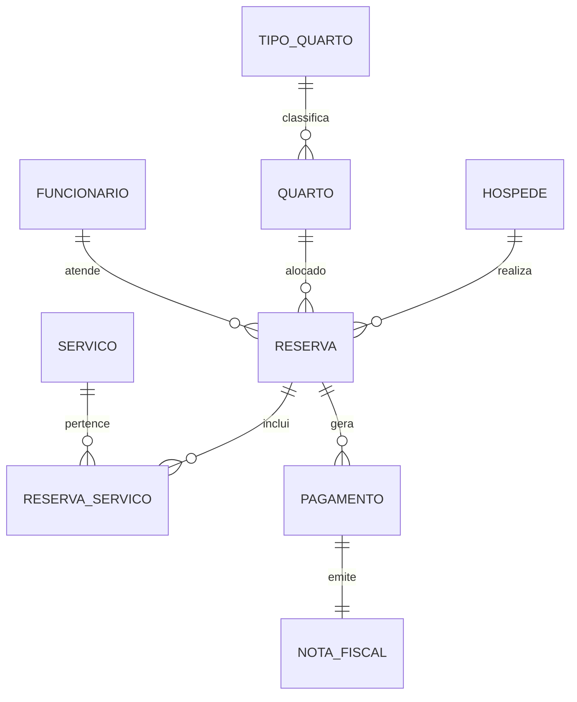

# 🏨 CENTRO UNIVERSITÁRIO UNA - BARREIRO
## PROJETO DE BANCO DE DADOS RELACIONAL (AVALIAÇÃO A3)
### Trilha de Aprendizagem: Oracle Academy

**Professores Orientadores:** Alexandre e Silvia  
**Tema Escolhido:** Sistema de Gerenciamento de Hotel ("Hotel Bela Vista")  
**Plataforma de Implantação Nuvem:** Supabase (PostgreSQL Cloud)  
**URL do Projeto Ativo:** [https://epoqmxqetzmscctlqfeo.supabase.co](https://epoqmxqetzmscctlqfeo.supabase.co)  

---

## 👥 INTEGRANTES DO GRUPO

| Nome do Aluno | Registro Acadêmico (RA) |
| :--- | :--- |
| **Esdras Andrade** | 326213247 |
| **Pedro Antônio** | 325223425 |
| **Lucas Miranda** | 325131396 |
| **Gabriel Ferreira** | *(Preencher RA)* |
| **Fernando Almeida** | 326132695 |
| **Cauã Mendes** | 326141078 |
| **Caio Duraes** | 325132875 |

---

## 📋 1. INTRODUÇÃO E CONTEXTO DA ORGANIZAÇÃO

### 1.1 Contexto da Organização Escolhida
O **Hotel Bela Vista** é um estabelecimento hoteleiro de médio porte que oferece acomodações divididas em diferentes categorias (Standard, Luxo, Suítes e Quartos Familiares), além de comodidades adicionais como restaurante interno, serviço de quarto, spa, lavanderia expressa e translado.

### 1.2 O Problema Identificado
Antes da implementação do banco de dados relacional, a gestão do hotel sofria com:
1. **Controle Manual em Planilhas e Papel:** Gerava duplicidade de cadastros de clientes e perda de histórico.
2. **Risco de Overbooking:** Choque de datas em que o mesmo quarto era reservado para mais de um hóspede no mesmo período.
3. **Descontrole sobre Consumo Extra:** Consumos no restaurante, minibar ou spa que deixavam de ser lançados no Check-out, gerando prejuízos financeiros.
4. **Dificuldade na Prestação de Contas:** Falta de rastreabilidade entre pagamentos efetuados e notas fiscais emitidas.

### 1.3 A Solução Proposta
Desenvolvemos um **Banco de Dados Relacional em PostgreSQL** estruturado com 9 tabelas interligadas por chaves primárias e estrangeiras, garantindo integridade referencial, integridade de domínio e regras de negócio rígidas. O banco foi implantado na nuvem através do **Supabase**, permitindo acesso centralizado e relatórios em tempo real para a gestão do hotel.

---

## 📐 2. MODELAGEM RELACIONAL E ESTRUTURA DO BANCO DE DADOS

### 2.1 Esquema Entidade-Relacionamento (Estrutura das Tabelas)



### 2.2 Dicionário de Tabelas

1. **`hospede`**: Armazena os dados cadastrais dos clientes (`id_hospede`, `nome`, `cpf`, `email`, `telefone`, `data_nascimento`, `logradouro`, `cidade`, `estado`, `cep`).
2. **`tipo_quarto`**: Define as categorias de acomodação e valores de diária (`id_tipo`, `nome`, `descricao`, `capacidade`, `preco_diaria`).
3. **`quarto`**: Cadastro das unidades físicas (`id_quarto`, `numero`, `id_tipo`, `andar`, `status`).
4. **`funcionario`**: Cadastro da equipe de recepção e gerência (`id_funcionario`, `nome`, `cpf`, `cargo`, `salario`, `data_admissao`, `telefone`, `ativo`).
5. **`reserva`**: Núcleo do sistema, relacionando Hóspede, Quarto e Funcionário (`id_reserva`, `id_hospede`, `id_quarto`, `id_funcionario`, `data_reserva`, `data_checkin`, `data_checkout`, `status`, `valor_total`).
6. **`servico`**: Catálogo de itens e comodidades adicionais (`id_servico`, `nome`, `descricao`, `preco`, `ativo`).
7. **`reserva_servico`**: Tabela associativa (N:M) que armazena a "comanda" de consumo extra (`id_reserva_servico`, `id_reserva`, `id_servico`, `quantidade`, `data_solicitacao`, `valor_unitario`).
8. **`pagamento`**: Histórico financeiro de transações (`id_pagamento`, `id_reserva`, `valor`, `data_pagamento`, `forma_pagamento`, `status`).
9. **`nota_fiscal`**: Registro de documentos fiscais vinculados aos pagamentos (`id_nota`, `id_pagamento`, `numero_nota`, `data_emissao`, `valor_total`, `descricao`).

---

## 💻 3. SCRIPT SQL COMPLETO (DDL, DML E DQL)

```sql
-- ============================================================
-- 1. DDL - DATA DEFINITION LANGUAGE (Criação de Tabelas)
-- ============================================================

CREATE TABLE hospede (
    id_hospede      SERIAL PRIMARY KEY,
    nome            VARCHAR(100) NOT NULL,
    cpf             CHAR(11)     NOT NULL UNIQUE,
    email           VARCHAR(100) NOT NULL UNIQUE,
    telefone        VARCHAR(20),
    data_nascimento DATE,
    logradouro      VARCHAR(150),
    cidade          VARCHAR(80),
    estado          CHAR(2),
    cep             CHAR(8),
    criado_em       TIMESTAMP DEFAULT NOW()
);

CREATE TABLE tipo_quarto (
    id_tipo      SERIAL PRIMARY KEY,
    nome         VARCHAR(50)   NOT NULL,
    descricao    TEXT,
    capacidade   INT           NOT NULL CHECK (capacidade > 0),
    preco_diaria NUMERIC(10,2) NOT NULL CHECK (preco_diaria > 0)
);

CREATE TABLE quarto (
    id_quarto SERIAL PRIMARY KEY,
    numero    VARCHAR(10)  NOT NULL UNIQUE,
    id_tipo   INT          NOT NULL REFERENCES tipo_quarto(id_tipo),
    andar     INT          NOT NULL,
    status    VARCHAR(20)  NOT NULL DEFAULT 'disponivel'
              CHECK (status IN ('disponivel','ocupado','manutencao','reservado'))
);

CREATE TABLE funcionario (
    id_funcionario SERIAL PRIMARY KEY,
    nome           VARCHAR(100)  NOT NULL,
    cpf            CHAR(11)      NOT NULL UNIQUE,
    cargo          VARCHAR(60)   NOT NULL,
    salario        NUMERIC(10,2) NOT NULL CHECK (salario > 0),
    data_admissao  DATE          NOT NULL,
    telefone       VARCHAR(20),
    ativo          BOOLEAN DEFAULT TRUE
);

CREATE TABLE reserva (
    id_reserva     SERIAL PRIMARY KEY,
    id_hospede     INT NOT NULL REFERENCES hospede(id_hospede),
    id_quarto      INT NOT NULL REFERENCES quarto(id_quarto),
    id_funcionario INT REFERENCES funcionario(id_funcionario),
    data_reserva   TIMESTAMP    NOT NULL DEFAULT NOW(),
    data_checkin   DATE         NOT NULL,
    data_checkout  DATE         NOT NULL,
    status         VARCHAR(20)  NOT NULL DEFAULT 'confirmada'
                   CHECK (status IN ('pendente','confirmada','em_andamento','concluida','cancelada')),
    valor_total    NUMERIC(10,2),
    observacoes    TEXT,
    CONSTRAINT chk_datas CHECK (data_checkout > data_checkin)
);

CREATE TABLE servico (
    id_servico SERIAL PRIMARY KEY,
    nome       VARCHAR(80)   NOT NULL,
    descricao  TEXT,
    preco      NUMERIC(10,2) NOT NULL CHECK (preco >= 0),
    ativo      BOOLEAN DEFAULT TRUE
);

CREATE TABLE reserva_servico (
    id_reserva_servico SERIAL PRIMARY KEY,
    id_reserva         INT           NOT NULL REFERENCES reserva(id_reserva),
    id_servico         INT           NOT NULL REFERENCES servico(id_servico),
    quantidade         INT           NOT NULL DEFAULT 1 CHECK (quantidade > 0),
    data_solicitacao   TIMESTAMP     NOT NULL DEFAULT NOW(),
    valor_unitario     NUMERIC(10,2) NOT NULL
);

CREATE TABLE pagamento (
    id_pagamento    SERIAL PRIMARY KEY,
    id_reserva      INT           NOT NULL REFERENCES reserva(id_reserva),
    valor           NUMERIC(10,2) NOT NULL CHECK (valor > 0),
    data_pagamento  TIMESTAMP     NOT NULL DEFAULT NOW(),
    forma_pagamento VARCHAR(30)   NOT NULL
                    CHECK (forma_pagamento IN ('dinheiro','cartao_credito','cartao_debito','pix','transferencia')),
    status          VARCHAR(20)   NOT NULL DEFAULT 'aprovado'
                    CHECK (status IN ('pendente','aprovado','recusado','estornado'))
);

CREATE TABLE nota_fiscal (
    id_nota      SERIAL PRIMARY KEY,
    id_pagamento INT           NOT NULL UNIQUE REFERENCES pagamento(id_pagamento),
    numero_nota  VARCHAR(20)   NOT NULL UNIQUE,
    data_emissao TIMESTAMP     NOT NULL DEFAULT NOW(),
    valor_total  NUMERIC(10,2) NOT NULL,
    descricao    TEXT
);

-- ============================================================
-- 2. DML - DATA MANIPULATION LANGUAGE (Inserção de Dados Teste)
-- ============================================================

INSERT INTO tipo_quarto (nome, descricao, capacidade, preco_diaria) VALUES
('Standard',      'Quarto padrão com cama de casal e ar-condicionado.',      2, 180.00),
('Standard Twin', 'Quarto padrão com duas camas de solteiro.',               2, 190.00),
('Luxo',          'Quarto luxo com cama king size e jacuzzi.',               2, 320.00),
('Suite Master',  'Suíte com sala de estar e vista panorâmica.',             3, 520.00),
('Familiar',      'Quarto amplo com cama de casal e beliche.',               4, 280.00);

INSERT INTO quarto (numero, id_tipo, andar, status) VALUES
('101', 1, 1, 'disponivel'),
('102', 1, 1, 'disponivel'),
('103', 2, 1, 'disponivel'),
('201', 3, 2, 'disponivel'),
('202', 3, 2, 'manutencao'),
('203', 5, 2, 'disponivel'),
('301', 4, 3, 'disponivel'),
('302', 4, 3, 'reservado'),
('104', 1, 1, 'ocupado'),
('204', 3, 2, 'disponivel');

INSERT INTO funcionario (nome, cpf, cargo, salario, data_admissao, telefone) VALUES
('Ana Beatriz Costa',   '11122233300', 'Recepcionista', 2200.00, '2022-03-01', '31991110001'),
('Ricardo Souza Lima',  '22233344411', 'Gerente Geral',  5500.00, '2020-06-15', '31991110002'),
('Claudia Mendes',      '33344455522', 'Camareira',      1800.00, '2023-01-10', '31991110003'),
('Thiago Nascimento',   '44455566633', 'Recepcionista',  2200.00, '2021-09-20', '31991110004'),
('Juliana Faria',       '55566677744', 'Concierge',      2600.00, '2022-07-05', '31991110005');

INSERT INTO hospede (nome, cpf, email, telefone, data_nascimento, logradouro, cidade, estado, cep) VALUES
('Carlos Eduardo Alves', '98765432100', 'carlos.alves@email.com',   '31988880001', '1985-04-12', 'Rua das Flores, 45',     'Belo Horizonte', 'MG', '30000001'),
('Mariana Oliveira',     '87654321099', 'mariana.oliveira@email.com','31988880002', '1992-08-23', 'Av. Brasil, 200',        'Sao Paulo',      'SP', '01000001'),
('Joao Pedro Santos',    '76543210988', 'joao.santos@email.com',    '31988880003', '1978-11-05', 'Rua XV de Novembro, 10', 'Curitiba',       'PR', '80000001'),
('Fernanda Lima',        '65432109877', 'fernanda.lima@email.com',  '31988880004', '1990-02-14', 'Rua Dom Pedro II, 88',   'Rio de Janeiro', 'RJ', '20000001'),
('Roberto Carvalho',     '54321098766', 'roberto.carvalho@email.com','11988880005', '1982-06-30', 'Av. Paulista, 1000',     'Sao Paulo',      'SP', '01310001'),
('Luciana Teixeira',     '43210987655', 'luciana.teixeira@email.com','31988880006', '1995-12-01', 'Rua Goias, 55',          'Uberlandia',     'MG', '38400001'),
('Andre Moura',          '32109876544', 'andre.moura@email.com',    '21988880007', '1988-03-25', 'Av. Atlantica, 300',     'Rio de Janeiro', 'RJ', '22010001'),
('Patricia Nunes',       '21098765433', 'patricia.nunes@email.com', '31988880008', '2000-07-19', 'Rua Pernambuco, 70',     'Belo Horizonte', 'MG', '30130001');

INSERT INTO reserva (id_hospede, id_quarto, id_funcionario, data_checkin, data_checkout, status, valor_total) VALUES
(1, 1, 1, '2026-09-10', '2026-09-13', 'concluida',    590.00),
(2, 4, 4, '2026-09-15', '2026-09-18', 'concluida',   1120.00),
(3, 7, 1, '2026-09-20', '2026-09-23', 'concluida',   1640.00),
(4, 3, 4, '2026-09-22', '2026-09-24', 'concluida',    430.00),
(5, 2, 1, '2026-10-01', '2026-10-05', 'em_andamento', 720.00),
(6, 6, 1, '2026-10-03', '2026-10-07', 'confirmada',  1200.00),
(7, 8, 4, '2026-10-05', '2026-10-08', 'confirmada',  1640.00),
(8,10, 1, '2026-10-10', '2026-10-12', 'pendente',     700.00);

INSERT INTO servico (nome, descricao, preco) VALUES
('Cafe da Manha Buffet',  'Cafe da manha completo com buffet variado.',        35.00),
('Almoco no Restaurante', 'Almoco a la carte no restaurante interno.',         65.00),
('Jantar Romantico',      'Jantar especial para dois com vinho incluso.',     180.00),
('Spa e Massagem',        'Sessao de 60 minutos no spa do hotel.',            120.00),
('Lavanderia Express',    'Lavagem e entrega em 4 horas.',                     45.00),
('Transfer Aeroporto',    'Translado hotel-aeroporto.',                        80.00),
('Aluguel de Bicicleta',  'Bicicleta disponivel por 1 dia.',                  30.00),
('Baby Sitter',           'Servico de baba credenciada por periodo de 3h.',   90.00),
('Minibar Premium',       'Reposicao completa do minibar com opcoes premium.', 55.00),
('Internet Fibra Otica',  'Upgrade de internet ultra-rapida no quarto.',       20.00);

INSERT INTO reserva_servico (id_reserva, id_servico, quantidade, valor_unitario) VALUES
(1, 1, 3,  35.00), (2, 1, 3,  35.00), (2, 4, 1, 120.00), (2, 6, 1,  80.00),
(3, 1, 3,  35.00), (3, 3, 2, 180.00), (3, 4, 1, 120.00), (4, 1, 2,  35.00),
(4, 5, 1,  45.00), (5, 1, 4,  35.00), (6, 1, 4,  35.00), (6, 8, 2,  90.00),
(6, 7, 2,  30.00), (7, 1, 3,  35.00), (7, 3, 1, 180.00), (7, 9, 3,  55.00);

INSERT INTO pagamento (id_reserva, valor, data_pagamento, forma_pagamento, status) VALUES
(1,  590.00, '2026-09-13 12:30:00', 'pix',           'aprovado'),
(2, 1120.00, '2026-09-18 14:00:00', 'cartao_credito','aprovado'),
(3, 1640.00, '2026-09-23 11:00:00', 'cartao_credito','aprovado'),
(4,  430.00, '2026-09-24 16:45:00', 'dinheiro',      'aprovado'),
(5,  360.00, '2026-10-01 14:00:00', 'cartao_debito', 'aprovado'),
(6,  600.00, '2026-10-03 15:20:00', 'pix',           'aprovado'),
(7, 1640.00, '2026-10-05 09:00:00', 'cartao_credito','aprovado');

INSERT INTO nota_fiscal (id_pagamento, numero_nota, data_emissao, valor_total, descricao) VALUES
(1, 'NF-2026-0001', '2026-09-13 12:35:00',  590.00, 'Hospedagem - Carlos Eduardo Alves'),
(2, 'NF-2026-0002', '2026-09-18 14:05:00', 1120.00, 'Hospedagem - Mariana Oliveira'),
(3, 'NF-2026-0003', '2026-09-23 11:05:00', 1640.00, 'Hospedagem - Joao Pedro Santos'),
(4, 'NF-2026-0004', '2026-09-24 16:50:00',  430.00, 'Hospedagem - Fernanda Lima'),
(5, 'NF-2026-0005', '2026-10-01 14:05:00',  360.00, 'Pagamento parcial - Roberto Carvalho'),
(6, 'NF-2026-0006', '2026-10-03 15:25:00',  600.00, 'Pagamento parcial - Luciana Teixeira'),
(7, 'NF-2026-0007', '2026-10-05 09:05:00', 1640.00, 'Hospedagem - Andre Moura');

-- ============================================================
-- 3. DQL - CONSULTAS ESTRATÉGICAS COM RELACIONAMENTOS (JOINs)
-- ============================================================

-- CONSULTA 1: Reservas Recentes
SELECT r.id_reserva, h.nome AS hospede, q.numero AS quarto, tq.nome AS tipo_quarto,
       r.data_checkin, r.data_checkout, (r.data_checkout - r.data_checkin) AS diarias,
       r.status, r.valor_total
FROM reserva r
JOIN hospede h ON r.id_hospede = h.id_hospede
JOIN quarto q ON r.id_quarto = q.id_quarto
JOIN tipo_quarto tq ON q.id_tipo = tq.id_tipo
WHERE r.data_reserva >= NOW() - INTERVAL '30 days'
ORDER BY r.data_reserva DESC;

-- CONSULTA 4: Taxa de Ocupação Operacional por Tipo de Quarto
SELECT tq.nome AS tipo_quarto, tq.preco_diaria, COUNT(q.id_quarto) AS total_quartos,
       SUM(CASE WHEN q.status = 'disponivel' THEN 1 ELSE 0 END) AS disponiveis,
       SUM(CASE WHEN q.status = 'ocupado' THEN 1 ELSE 0 END) AS ocupados,
       SUM(CASE WHEN q.status = 'reservado' THEN 1 ELSE 0 END) AS reservados,
       SUM(CASE WHEN q.status = 'manutencao' THEN 1 ELSE 0 END) AS em_manutencao
FROM tipo_quarto tq
LEFT JOIN quarto q ON tq.id_tipo = q.id_tipo
GROUP BY tq.id_tipo, tq.nome, tq.preco_diaria
ORDER BY tq.preco_diaria;

-- CONSULTA 6: Programa de Fidelidade (Clientes Frequentes)
SELECT h.id_hospede, h.nome AS hospede, h.email, h.telefone,
       COUNT(r.id_reserva) AS total_reservas, SUM(r.valor_total) AS total_gasto,
       MAX(r.data_checkin) AS ultima_estadia
FROM hospede h
JOIN reserva r ON h.id_hospede = r.id_hospede
WHERE r.status <> 'cancelada'
GROUP BY h.id_hospede, h.nome, h.email, h.telefone
ORDER BY total_reservas DESC, total_gasto DESC;
```

---

## 📸 4. EVIDÊNCIAS DE FUNCIONAMENTO NA NUVEM (SUPABASE)

O banco de dados foi publicado com sucesso no **Supabase Cloud**. A imagem abaixo comprova a criação do Schema e visualização da tabela `tipo_quarto` diretamente no painel do Supabase:

> 📌 *(Cole aqui o print capturado da tela do Supabase Table Editor)*

* **URL de Acesso ao Projeto:** [https://epoqmxqetzmscctlqfeo.supabase.co](https://epoqmxqetzmscctlqfeo.supabase.co)
* **Status da Instância:** Ativo e operando em nuvem.

---

## 🏁 5. CONCLUSÃO

O projeto atendeu rigorosamente a todas as especificações da atividade A3 e da trilha Oracle Academy. A transição dos registros do **Hotel Bela Vista** para um Banco de Dados Relacional PostgreSQL eliminou o risco de sobreposição de reservas, garantiu a tarifação automatizada de consumo extra e forneceu relatórios decisivos para a gerência do hotel.

---
*Centro Universitário UNA - Barreiro | 2026*
